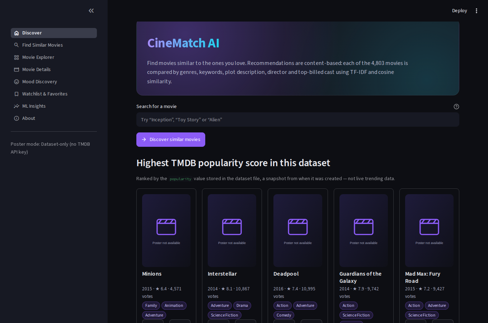

# CineMatch AI — Content-Based Movie Recommender

A complete Streamlit application that recommends movies by **content similarity** (TF-IDF + cosine similarity) on the
TMDB 5000 dataset, explains every recommendation, and includes search, filters, mood discovery, a local watchlist,
an ML-insights dashboard and an honest evaluation section. Built as an academic / portfolio project.



## Features
- **Discover** – search, most-popular-in-dataset list, genre exploration, recently selected movies.
- **Find Similar Movies** – ranked top 5/10/20 with content-similarity scores, genre & year filters and a verifiable "Why" line.
- **Movie Explorer** – title search, genre multiselect, year range, min rating, min votes, sorting, pagination.
- **Movie Details** – metadata, similar movies, watchlist / favorite / personal 1–5 star rating.
- **Mood Discovery** – seven moods ranked by transparent, visible rules (not a trained emotion model).
- **Watchlist & Favorites** – persisted in local SQLite.
- **ML Insights** – concepts, dataset stats, charts, model facts, evaluation, limitations (all computed from the data).
- **Posters** – placeholder by default; real posters via an *optional* TMDB API key. The ML engine never needs it.

## Technology
Python 3.11/3.12 · Streamlit · pandas/NumPy · scikit-learn · Plotly · SQLite · Requests · pytest.
Developed and tested on Python 3.12, Streamlit 1.66, pandas 3.0, scikit-learn 1.8.

## Quick start
```bash
python -m venv .venv
source .venv/bin/activate            # Windows: .venv\Scripts\activate
pip install -r requirements.txt
# put tmdb_5000_movies.csv and tmdb_5000_credits.csv in ./data  (see "Dataset")
streamlit run app.py
```
Open http://localhost:8501. The first load takes a few seconds (data preparation + TF-IDF fit); after that it is cached.

## Dataset
Download the **TMDB 5000 Movie Dataset** from Kaggle (<https://www.kaggle.com/datasets/tmdb/tmdb-movie-metadata>; free account,
read the terms on that page) and place the two files in `data/`, or point `CINEMATCH_DATA_DIR` at their folder.
If they are missing the app shows a setup screen naming the required files — nothing is invented.

Notes about the real files: they contain **no `poster_path` column** (so posters need the optional API), 4,803 movies,
and 62 movies with zero votes (shown as "Not rated", never as 0.0). Three titles belong to two different films each
(e.g. *Batman* 1966/1989), so the UI identifies movies by id / "Title (Year)".

## How the ML pipeline works
1. **Load & validate** both CSVs (`src/data_loader.py`).
2. **Clean & merge** on movie id (`src/preprocessing.py`): safe JSON parsing, duplicate removal, missing-value handling,
   director from crew, top-3 cast (configurable). A data-quality report is kept and shown in the app.
3. **Feature text** – one string per movie from genres, keywords, director, cast, overview. *Feature weighting* is explicit
   and reproducible (`FeatureWeights`): tokens are repeated genres×3, keywords×2, director×2, cast×1, overview×1.
   Genres/people are single tokens (`science_fiction`, `sam_worthington`); keyword phrases are split into words.
4. **TF-IDF** – `TfidfVectorizer(max_features=20000, stop_words="english", ngram_range=(1,2), min_df=2)` →
   sparse matrix (4,803 × 20,000, ~0.2 % non-zero). A term is heavy when frequent in one movie and rare overall.
5. **Cosine similarity** – one sparse row-vs-matrix product per query (~10 ms); the N×N matrix is never stored.
6. **Ranking** (`recommend_movies(title, top_n)`) – excludes the selected movie, applies genre/year filters, sorts by
   score with deterministic tie-break (movie id), returns distinct movies with scores and explanations.
7. **Explanations** list only attributes verifiably shared in the data: genres, keywords, director, cast, rare overview words.

```python
from src.recommender import recommend_movies
recs = recommend_movies("The Dark Knight", top_n=5)   # needs the CSVs; or pass recommender=...
print(recs[["rank", "label", "similarity_score", "explanation"]])
```
The score is a **content-similarity score** in [0, 1]. It is not a probability, and not a prediction of personal enjoyment.

## Evaluation (honest summary)
The dataset has no user behaviour, so true relevance labels do not exist. See `docs/evaluation_report.md`
(regenerate: `python -m src.evaluation --out docs/evaluation_report.md`) and the in-app *ML Insights → Evaluation* tab.
Results from the run included in this repo (TMDB 5000, K = 10):
- **Franchise proxy** (relevant = other movies with the same title stem, 439 queries / 174 groups): Recall@10 = 0.77,
  Hit-rate@10 = 0.83, Precision@10 = 0.16 (precision is capped because most groups have only 1–5 siblings).
  This measures sequel retrieval only and has label noise (e.g. *Halloween III* is unrelated to the other Halloween films).
- **Coverage** 97.7 % of movies appear in some top-10 list; **intra-list diversity** 0.84; median top-10 similarity 0.20.
- **Informal manual spot-checks** by the author (not a user study): *The Dark Knight* → Dark Knight Rises, Batman Begins,
  Batman Returns (strong; shared director/cast/keywords). *Toy Story* → Toy Story 2/3, Small Soldiers (strong).
  *Titanic* → low scores (~0.17) and loosely related films (weak: generic overview, few distinctive keywords).
- Scores are low for many movies; short or generic descriptions give weak matches.

## Optional TMDB poster mode
1. Create a free TMDB account and API key (<https://www.themoviedb.org/settings/api>) and follow TMDB's terms.
2. Put `TMDB_API_KEY=...` in `.env` (copy `.env.example`) **or** in `.streamlit/secrets.toml` (copy `secrets.toml.example`).
3. Restart. The sidebar shows "TMDB API (posters)". Responses are cached in memory (24 h; failures 10 min), calls time out
   after 5 s, 429 responses pause requests, and a 401 disables the client. Never commit keys (both files are git-ignored).

*This product uses the TMDB API but is not endorsed or certified by TMDB.*

## Tests
```bash
pip install -r requirements-dev.txt
python -m pytest                                  # unit tests (real-data tests skip if CSVs are absent)
CINEMATCH_DATA_DIR=/path/to/csvs python -m pytest # also runs real-data + Streamlit page tests
```
Unit tests use a small **synthetic** fixture ("Test Movie …", never shown in the app). Results in the build environment:
102 passed with the real dataset; 97 passed + 5 skipped (real-data tests) without it.

## Project structure
```
app.py                 navigation + theme + sidebar
pages/                 0_Home … 7_About (st.navigation pages)
src/  data_loader · preprocessing · recommender · mood · evaluation · storage · tmdb_client · ui
tests/ data loading, parsing, features, ranking, storage, TMDB client, moods, evaluation, real data, page smoke tests
data/  put the CSVs here        assets/placeholder.svg        docs/evaluation_report.md
```

## Deployment (Streamlit Community Cloud)
1. Push the project to GitHub. The CSVs are git-ignored on purpose.
2. **Data:** the app needs the CSVs at runtime. Simplest option: use a **private** repository and force-add the two files
   (`git add -f data/*.csv`; credits file ≈ 40 MB, under GitHub's 100 MB limit). Check the dataset terms before redistributing
   it publicly. Otherwise the deployed app shows the setup screen.
3. On <https://share.streamlit.io> choose the repo, branch and `app.py`; Python 3.12.
4. Optional: App settings → Secrets → `TMDB_API_KEY = "..."`.
5. **Privacy:** the SQLite watchlist is one shared file on the server — every visitor would see the same lists. Fine for a
   demo on your own machine; before a public launch add authentication and per-user storage.

## Troubleshooting
| Symptom | Fix |
|---|---|
| "Dataset setup needed" | Put both CSVs in `data/` (exact filenames) or set `CINEMATCH_DATA_DIR`. |
| `ModuleNotFoundError: src` | Run from the project root: `streamlit run app.py`. |
| Posters are all placeholders | Expected without an API key; the CSVs have no poster paths. |
| Stale results after changing data | Streamlit menu → *Clear cache*, or restart. |
| Port busy | `streamlit run app.py --server.port 8502`. |

## Limitations
Content-only (no personalisation), static 2017-era snapshot, TF-IDF matches words not meaning, mood matching is approximate,
local single-user storage. Possible improvements: sentence embeddings, hybrid/collaborative filtering, diversity re-ranking,
human-labelled relevance judgements.

## Attribution
Movie data: TMDB 5000 Movie Dataset (Kaggle), derived from The Movie Database (TMDB). Check the dataset page for its terms.
